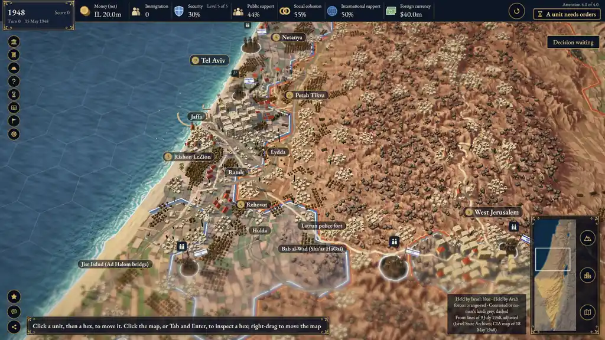
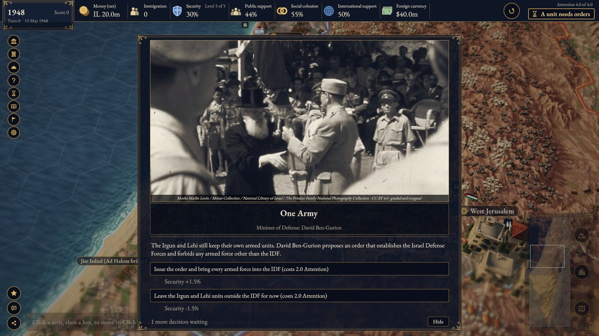
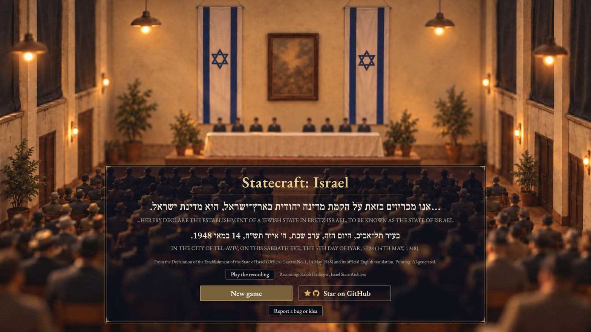
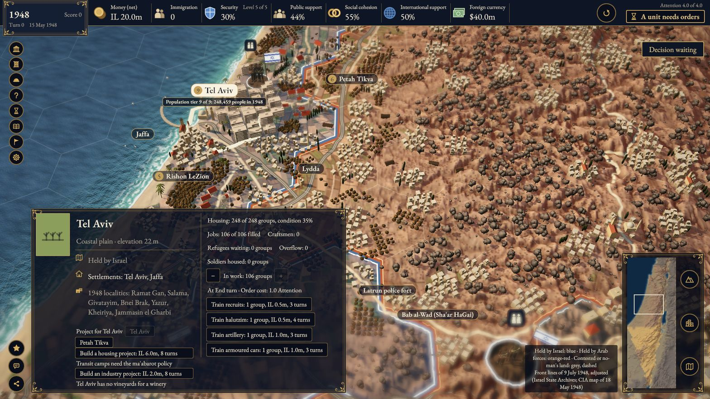
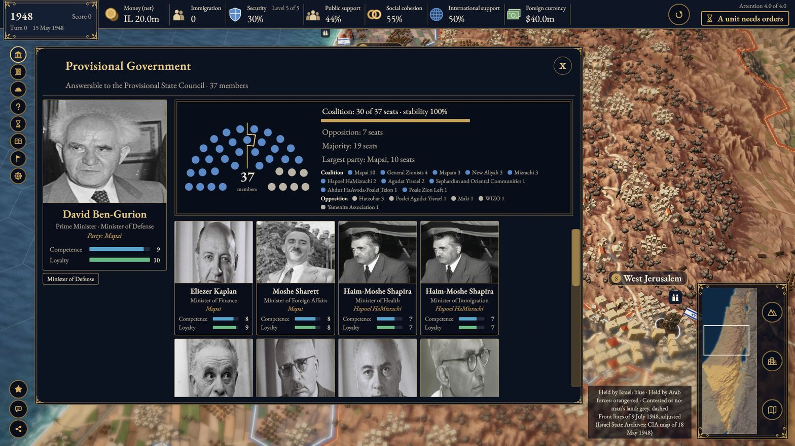
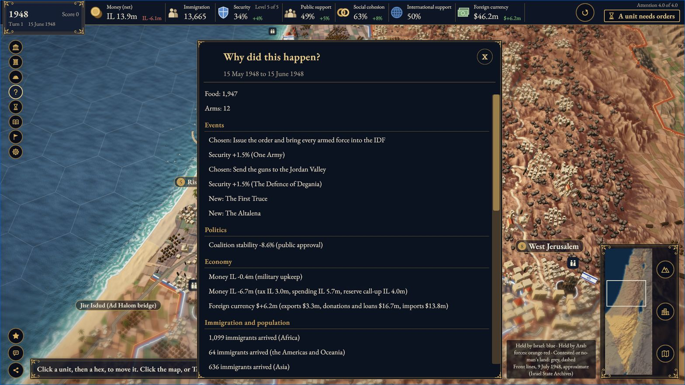

**English** · [עברית](README.he.md)

https://github.com/user-attachments/assets/56571db8-446b-444b-8db9-fce57dac53a7

<em>The cinematic trailer (1:23, with sound), made with AI video tools and AI music (ElevenLabs Music) from our concept art; it is not in-game footage.</em>

# Statecraft: Israel

**A turn-based grand-strategy game about governing Israel. You are the prime minister on 15 May 1948. The ministers are the real ones, the map is real, and every historical fact comes with a source.**

> [!NOTE]
> This is an independent open-source project. The game is free and non-commercial. It is not affiliated with or endorsed by Firaxis, 2K, the State of Israel or any person depicted. The game deals with war, terror and the Holocaust as historical events. Its framing is Israeli, every fact cites a source, and no quotes are invented. See [Historical content](#history-sources-and-accuracy).

##### [Report a bug](https://github.com/eyalgolan/statecraft-israel/issues/new?template=bug_report.yml) | [Report a historical error](https://github.com/eyalgolan/statecraft-israel/issues/new?template=historical_accuracy.yml) | [Discussions](https://github.com/eyalgolan/statecraft-israel/discussions) | [Roadmap](#roadmap) | [Changelog](CHANGELOG.md)

## What is this?

  
   
  <em>Concept art (AI-generated): the look we are building toward, set in 1936, before the game's 1948 start. It is not the current build, and it shows things the game does not have. Real screenshots of today's build are <a href="#what-it-looks-like-today">below</a>.</em>

You sit in the prime minister's chair from the founding of the state. Each turn you:

- appoint and replace real ministers such as David Ben-Gurion, Eliezer Kaplan and Moshe Sharett, inside a real coalition;
- divide a tiny budget between security, immigrant absorption, the ma'abarot transit camps and austerity;
- manage security on a five-level escalation ladder, from routine threats to full war;
- face real decisions at their real dates, such as the First Truce, the Altalena affair and the Bernadotte assassination, and see why each outcome happened in the "Why?" panel.

A deterministic C# simulation runs underneath. The same choices always give the same result, and a saved game is the seed plus the list of commands. Unity draws a real terrain map of the country built from elevation and climate data.

The game design of record is now [docs/GDD.md](docs/GDD.md) (12 October 2026): monthly turns in which you build and defend Israel from 1948 to 1951 with units, cities and construction, and choose your ministers. The list above is the game you can play today. The new design is not playable yet; the [build plan](docs/superpowers/specs/2026-10-12-gdd-v0.1-impact-and-plan.md) brings it in phases.

## What it looks like today

  
   <em>Real gameplay, build 0.1.0, 2026-10-13, commit f93fd5e.</em>

  

  
  
   
  
  
   <em>Real screenshots from build 0.1.0 (M3), 2026-10-13. Taken at commit f93fd5e. The start screen's painting is AI-generated.</em>

## Is this any good?

It is an early, honest prototype.

**What works now (M3, 1948–1951):**
- Turns from 15 May 1948 to the end of 1951.
- The start screen.
- The 1948 map: towns, villages and Bedouin camps, railways and roads, and the 1949 armistice zones and lines from each agreement's date.
- The 1948 brigades, 101 Squadron and the first navy ships as tokens at their sourced positions. They take no orders yet.
- The Cabinet with appointments.
- The Budget screen.
- The Defence screen with the escalation ladder and reserve call-up.
- Sourced historical events from the 1948 war through the 1951 foreign-currency crisis, most with an archival photograph.
- The "Why?" panel.
- Autosave and load.
- The browser (WebGL) build.

**What is missing:**
- The art in the concept image above. Settlements and trees are still placeholder art.
- Everything new in the [GDD](docs/GDD.md): one month per turn, units you train and command, cities with housing and jobs, construction, combat and the three objectives.
- Diplomacy.
- Anything after 1951.
- A hosted build you can play with one click.

## Roadmap

The live tracker is [#374](https://github.com/eyalgolan/statecraft-israel/issues/374). The plan behind it is the [GDD v0.1 build plan](docs/superpowers/specs/2026-10-12-gdd-v0.1-impact-and-plan.md). The roadmap sets no dates.

### Main track: the 1948 to 1951 MVP

| Phase | What it adds | Status | Issue |
|---|---|---|---|
| 0 | Owner decisions on the open GDD items | In progress: the Phase 1 decisions are made | [#375](https://github.com/eyalgolan/statecraft-israel/issues/375) |
| 1 | A first slice behind a switch: one city (Tel Aviv), training, one new settlement and one objective card | In progress: 6 of 8 PRs merged | [#374](https://github.com/eyalgolan/statecraft-israel/issues/374) |
| 2 | Monthly turns for the real game, and the five resources | In progress: monthly turns and Money are done | [#382](https://github.com/eyalgolan/statecraft-israel/issues/382) |
| 3 | Every city, with housing, jobs and immigrant absorption | Later | [#383](https://github.com/eyalgolan/statecraft-israel/issues/383) |
| 4 | Pioneers, building sites, roads and railways | Later | [#384](https://github.com/eyalgolan/statecraft-israel/issues/384) |
| 5 | Military units, movement and combat | Later | [#385](https://github.com/eyalgolan/statecraft-israel/issues/385) |
| 6 | Settlement control, under [docs/CONTENT_POLICY.md](docs/CONTENT_POLICY.md) | Later | [#386](https://github.com/eyalgolan/statecraft-israel/issues/386) |
| 7 | Ministers, events and the full 44-turn game | Later | [#387](https://github.com/eyalgolan/statecraft-israel/issues/387) |

### Other tracks

- **Art:** era-correct 3D settlements, vegetation and units, toward the concept image.
- **Release (M4):** a historian review and a hosted browser build.
- **Platforms:** desktop builds and Steam ([#54](https://github.com/eyalgolan/statecraft-israel/issues/54)).
- **Later eras:** the Yishuv before 1948, and the years after 1956, are paused until the MVP is done ([#49](https://github.com/eyalgolan/statecraft-israel/issues/49) to [#53](https://github.com/eyalgolan/statecraft-israel/issues/53)).

## Play

There is no hosted build yet; one is planned for M4. To run it locally:

1. Install the tools in [docs/dev-setup.md](docs/dev-setup.md): .NET 10, Unity 6000.3.25f1 with Web Build Support, and `uv`.
2. Run `uv run tools/build_sim_for_unity.py`.
3. Build the web version. The command is in [docs/dev-setup.md](docs/dev-setup.md).
4. Run `python3 -m http.server 8000 --directory unity/Builds/Web-disabled`, then open http://localhost:8000/.

The exact commands are in [BUILDING.md](BUILDING.md).

**First open in Unity.** The game scene is `Assets/Map.unity`, and it opens automatically. If it doesn't (you see an empty "Untitled" scene), double-click `Map` in the Project window's Assets folder. Then press Play.

Troubleshooting: `error CS0246 'PlayerPrefsBool'` means the Unity-MCP package (`com.ivanmurzak.unity.mcp`) is missing its OpenUPM registry (`https://package.openupm.com`); restore `Packages/manifest.json` and `Packages/packages-lock.json` from git. If the Console shows compile errors from a package that isn't in our `Packages/manifest.json`, remove that package from your local manifest or update it. Unity can't run while there is any compile error. More in [BUILDING.md](BUILDING.md).

## History, sources and accuracy

- Every event, minister, date and number in `content/` carries `sources:` with URLs and check dates. Wikipedia (English and Hebrew) is a primary cited source for many facts, which is why `content/` is CC BY-SA 4.0.
- The model behind the game, and its framing, embed assumptions. It is not neutral, and this page says so.
- No quotes are invented. Text paraphrases its sources.
- The framing is Israeli. Contested narratives are not presented as parallel accounts.
- Events about war, terror and the Holocaust are tagged sensitive. They get a sensitivity review before any build is shared, and the build tools refuse to package until it is recorded. Historian review is planned for M4.
- Found an error? Use the [historical error form](.github/ISSUE_TEMPLATE/historical_accuracy.yml). It asks for a source, because a claim without one can't be acted on. The full rules: [docs/CONTENT_POLICY.md](docs/CONTENT_POLICY.md).

## Contributing

Help is very welcome:
- **Programmers:** Unity, C# and Python tools.
- **Historians and history enthusiasts:** sourcing and fact-checking.
- **3D artists.**
- **Game designers and writers.**
- **Translators.**

Before you start:
- Read [docs/dev-setup.md](docs/dev-setup.md).
- Run the tests listed in [CONTRIBUTING.md](CONTRIBUTING.md).
- Adding a historical event? Read [docs/WRITING_EVENTS.md](docs/WRITING_EVENTS.md).
- Keep game rules in the sim, not in Unity.
- Working in Unity with an AI agent? Use the bundled Unity-MCP plugin in local Custom mode; the steps are in [CONTRIBUTING.md](CONTRIBUTING.md).

Start with **[CONTRIBUTING.md](CONTRIBUTING.md)**. There's no CLA: contributions come in under the repo's licences.

Looking for a first task? Browse the [good first issue](https://github.com/eyalgolan/statecraft-israel/labels/good%20first%20issue) and [help wanted](https://github.com/eyalgolan/statecraft-israel/labels/help%20wanted) filters, or the [open issues](https://github.com/eyalgolan/statecraft-israel/issues) (the `help wanted` label marks tasks that are ready to pick: research, content, design, translation and tests).

## Build from source

You need Unity **6000.3.25f1 (6.3 LTS)** with Web Build Support; the exact version is in [`unity/ProjectSettings/ProjectVersion.txt`](unity/ProjectSettings/ProjectVersion.txt). Clone, run `uv run tools/build_sim_for_unity.py`, add `unity/` in Unity Hub and open `Assets/Map.unity`. The batch build, the tests and the browser check are in [BUILDING.md](BUILDING.md).

## AI use

This project is built with heavy AI assistance, disclosed here using itch.io's categories:
- **Code:** written with AI coding agents and reviewed through tests and review gates.
- **Graphics:** the concept and promo images in `promo/` are AI-generated, as is the start screen's painting, and the web page's tab icon was drawn with AI help. The game's terrain comes from real elevation data. The portraits are public-domain, CC0 or CC BY 4.0 photographs (credited in NOTICE), and the event cards use archival photographs; on some cards an Illustration switch plays a short, silent AI-generated loop, and a few historical orders show a short AI-generated clip at End turn, both labelled as such.
- **Text:** event and content text was drafted with AI, and every fact is checked against the cited source.
- **Sound:** no AI sound. The start screen can play the original 1948 recording of Ben-Gurion reading the Declaration (Israel State Archives).

Nothing is generated live while you play.

## License

- **Code:** [MIT](LICENSE).
- **Original art, docs and data:** [CC BY 4.0](LICENSES/CC-BY-4.0.txt).
- **Game content text** (`content/`, which paraphrases its sources, many from Wikipedia): [CC BY-SA 4.0](LICENSES/CC-BY-SA-4.0.txt).
- **AI-generated images:** marked [CC0](LICENSES/CC0-1.0.txt), with no rights claimed.
- **Third-party material:** fonts, public-domain, CC0 and CC BY 4.0 portraits, the archival event photographs, Ben-Gurion's 1948 recording, and the Unity engine and packages are under their own terms.

Details are in [LICENSING.md](LICENSING.md); attributions are in [NOTICE](NOTICE) and [THIRD-PARTY-NOTICES.md](THIRD-PARTY-NOTICES.md), and every image's source is in [ASSETS.yaml](ASSETS.yaml).

## Community and credits

Questions and ideas go in [Discussions](https://github.com/eyalgolan/statecraft-israel/discussions); bugs and historical errors go in the [issue tracker](https://github.com/eyalgolan/statecraft-israel/issues). Report security problems privately ([SECURITY.md](SECURITY.md)). [CODE_OF_CONDUCT.md](CODE_OF_CONDUCT.md) applies everywhere.

Created by Eyal Golan. Source credits live with each fact in `content/`, the portrait credits are in `content/people.yaml`, and third-party credits are in [THIRD-PARTY-NOTICES.md](THIRD-PARTY-NOTICES.md).

