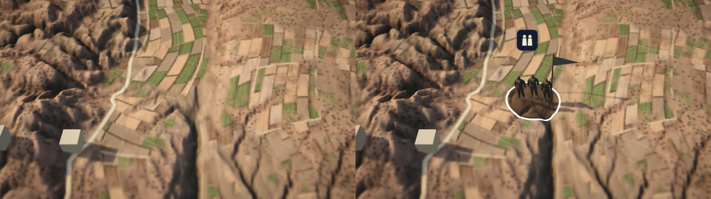
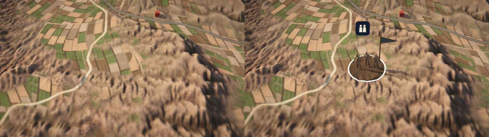

# Generated 1948 characters

Seven characters generated by Tal Heuberger on 22 October 2026, credited under CC BY-NC-ND 4.0. Exact provider GLBs and their embedded 4096px JPEG payloads are retained in `asset-sources/generated-1948/`. The provider supplied GLB, not FBX. The Unity FBX files are explicitly documented compatibility conversions preserving full source geometry and skin weights. Provider rigged GLBs contain zero animation clips. Both existing local idle/walk retargets are retained at every frame without key reduction. The six token figures (the Syrian, Iraqi, Egyptian and ALA infantry, the Lebanese regular and the local Arab irregular) also get a walk state, and an attack state where their model has a fire take, in their controllers (`CollectionImport.AddMotionStates`); a moving token plays the walk (`UnitTokenMotion`). The Bedouin civilian keeps idle only. Exact authoring F-curves, keys and handles are archived as byte-verified gzip JSON (archival data only); FBX interpolation conversion has measured numerical differences, recorded per character.

## Placement and loading

The owner signed off all of Tal Heuberger's generated models on 27 October 2026 (#756, "Sign off all 19"). Syrian and Iraqi infantry keep their existing sourced formation mappings. The Egyptian infantry stand on the Egyptian Expeditionary Force's token, drawn as one token (owner, 27 October 2026, "One token"; docs/units.md), and stream in a bundle of their own, `collection-figure-egyptian-infantry-1948-v1`, opened after the people's. The original C09 remains on campaign ALA tokens, and the new ALA infantry stands as their third figure (owner, 27 October 2026, "Third figure (Recommended)"), in a bundle of its own, `collection-figure-ala-infantry-1948-v1`, opened after the people's. The Lebanese regular stands on the Lebanese army's map-only token at al-Malikiyya from 6 June to 8 July 1948 (owner, 27 October 2026, "Map-only token (Recommended)"; 28 October 2026, "6 Jun to 8 Jul (Recommended)"), in a bundle of its own, `collection-figure-lebanese-regular-1948-v1`, opened after the people's. The Bedouin civilian stands at up to three served Bedouin camp areas, those of the camels (CivilianPeople), in its own bundle opened after the people's. The recreated local irregular is the local forces' token figure (owner, 2 November 2026: "Use it instead of C09", which replaces the 1 November 2026 ruling on #1243, "Map figure: C09 after photo check"), in a bundle of its own, `collection-figure-local-arab-irregular-1948-v1`, opened after the people's. No local-forces row exists (the 1 November ruling "Starting strength on 15 May: No row until sourced" still stands), so no token draws it and it is never streamed until a sourced row is added.

The Syrian and Iraqi characters share their own bundle after the first frame; the Egyptian and ALA infantry, the Lebanese regular, the Bedouin civilian, the local Arab irregular, the enclosed Bedouin tent, the Egyptian Spitfire, the Syrian Renault R35 at Degania Alef, the Egyptian Dakota, the five generated houses, the khaki canvas tent and the four props (the well, sandbags, crates and wall) each have their own. Both zoom levels use the same full model; there is no decimated far copy or automatic reduction of these characters. The 23 town buildings are the exception: each has a `-far` copy in a bundle of its own (#2378). The older collection and its import path remain the maintainer’s #1273 lane. The catalog now holds 103 models in 125 bundles (the Syrian and Iraqi characters share one; the other models have one each, and the 23 far copies of the town buildings add 23), including 29 animated models (`CollectionCatalog.Ids`, `Bundles`, `Animated`; `CollectionImportTests` pins 103, 125 and 29). The 103 are the 80 in `CollectionCatalog.Groups` and the 23 town building models of `Kits.TownModels`. The groups hold 22 people (the 1948 soldier's rigged copy among them), 13 vehicles, 6 animals, 10 whole-town models, 5 special buildings, the 2 Syrian and Iraqi characters, the 5 other generated characters, 9 generated props, 4 generated towns, 2 weapons, the C06 point-fire pose source and the project's own Blender-built 101 Squadron Spitfire (#2734, not one of Tal Heuberger's models). A gzip WebGL build of #2274 ships 93 bundles in `StreamingAssets/collection` (its `collection-checks.txt`; 87 on main before it). Player first-download growth and People bundle bytes require actual build measurement; no estimate is called a measurement.

## Import and review

`Generated1948Characters.Run` explicitly imports the seven named characters with mesh and animation compression Off, no Crunch, original-size maps and all available clips. Runtime prefabs play idle at rest and, for the six token figures, walk when their token moves (see above). `CollectionImport` delegates the seven runtime generated characters to this full-quality importer and preserves older import settings. Original C09 model files and metadata remain unchanged.

Open `Assets/Editor/Generated1948CharacterReview.unity`, or use Statecraft → Character review → Play seven generated characters. The stage is isolated, not a historical map or player capture. Camera angle, idle/walk, orientation and floor-contact checks remain available.

## Evidence

The previous ALA replacement comparison is superseded: C09 was restored in b73edefc and is still retained. Current campaign comparisons must show Syria and Iraq at matched state/camera/zoom; before is the same sourced formation without the new art, after is the new token. No invented deployment or C09 replacement is part of these comparisons.

The source-export manifests identify every original, map and compatibility conversion by SHA-256, triangle count, bone count and clip inventory. Any actual build or test limitation is reported in the PR rather than inferred from import success. The new contribution-consent line is not accepted by technical changes; Tal’s personal agreement remains separate.

Current matched Unity Editor map comparisons (20 June 1948, same sourced roster, camera and lighting; before left, after right):

These use the dated legacy roster as a rendering fixture, not a WebGL/player or GDD campaign run. The older isolated idle/walk/far review sheets are historical reduced-candidate diagnostics, not current source-quality evidence. The original ALA comparison experiments were removed from the current review because C09 is preserved.

Current focused Unity result: 55 passed, one bundle-build failure with the baseline Collections CS7036 error. People bytes remain unmeasured; 6,309,797 bytes is the maintainer-reported main baseline. The Syrian and Iraqi figures use their shared streamed bundle after the first frame; the Egyptian and ALA infantry and the Bedouin civilian each use their own bundle after the people's; no replacement streaming system or first-download binary growth measurement is claimed.

Upstream #1448 is preserved by a clean normal merge of main `703d87cf`. Post-merge character/mapping/raised-unit checks: 48 passed, zero failed; standalone Unity assembly compile: zero warnings/errors. The original C09 ALA role and the Syrian/Iraqi mappings remain intact.
