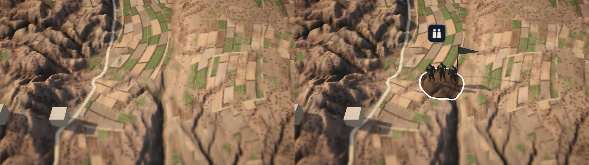
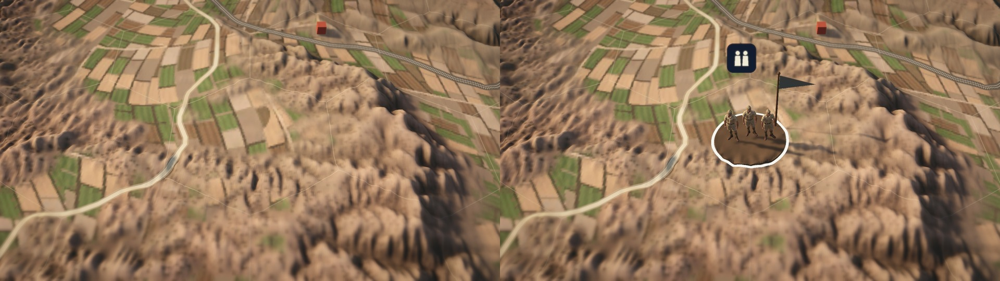

# Generated 1948 characters

Seven characters generated by Tal Heuberger on 22 October 2026, credited under CC BY-NC-ND 4.0. Exact provider GLBs and their embedded 4096px JPEG payloads are retained in `asset-sources/generated-1948/`. The provider supplied GLB, not FBX. The Unity FBX files are explicitly documented compatibility conversions preserving full source geometry and skin weights. Provider rigged GLBs contain zero animation clips. Both existing local idle/walk retargets are retained at every frame without key reduction; no new animation behavior is added. Exact authoring F-curves, keys and handles are archived as byte-verified gzip JSON (archival data only); FBX interpolation conversion has measured numerical differences, recorded per character.

## Placement and loading

Syrian and Iraqi infantry retain their existing sourced formation mappings, pending maintainer art/sensitivity sign-off (#756). The original C09 remains on campaign ALA tokens. The new ALA candidate, Egyptian infantry, Lebanese regular, Bedouin civilian and recreated local irregular are editor-only review art under `Assets/Editor/Generated1948Review/`. They are absent from People and Animated catalogs, Resources, all build scenes and runtime dependencies. No force or historical deployment is added.

Only the two runtime characters join the existing People stream after the first frame. Both zoom levels use the same full model; there is no decimated far copy or automatic reduction. The older collection and its import path remain the maintainer’s #1273 lane. Collection totals are 57 models, 23 People and 23 Animated. Player first-download growth and People bundle bytes require actual build measurement; no estimate is called a measurement.

## Import and review

`Generated1948Characters.Run` explicitly imports the seven named characters with mesh and animation compression Off, no Crunch, original-size maps and all available clips. Runtime prefabs use idle only; walk is available for review. `CollectionImport` delegates only the two named new figures to this full-quality importer and preserves older import settings. Original C09 model files and metadata remain unchanged.

Open `Assets/Editor/Generated1948CharacterReview.unity`, or use Statecraft → Character review → Play seven generated characters. The stage is isolated, not a historical map or player capture. Camera angle, idle/walk, orientation and floor-contact checks remain available. Five review characters cannot become build dependencies merely by opening this scene.

## Evidence

The previous ALA replacement comparison is superseded: C09 was restored in b73edefc and is still retained. Current campaign comparisons must show Syria and Iraq at matched state/camera/zoom; before is the same sourced formation without the new art, after is the new token. No invented deployment or C09 replacement is part of these comparisons.

The source-export manifests identify every original, map and compatibility conversion by SHA-256, triangle count, bone count and clip inventory. Any actual build or test limitation is reported in the PR rather than inferred from import success. The new contribution-consent line is not accepted by technical changes; Tal’s personal agreement remains separate.

Current matched Unity Editor map comparisons (20 June 1948, same sourced roster, camera and lighting; before left, after right):

These use the dated legacy roster as a rendering fixture, not a WebGL/player or GDD campaign run. The older isolated idle/walk/far review sheets are historical reduced-candidate diagnostics, not current source-quality evidence. The original ALA comparison experiments were removed from the current review because C09 is preserved.

Current focused Unity result: 55 passed, one bundle-build failure with the baseline Collections CS7036 error. People bytes remain unmeasured; 6,309,797 bytes is the maintainer-reported main baseline. The new full-quality figures use the existing streamed People bundle after the first frame; no replacement streaming system or first-download binary growth measurement is claimed.

Upstream #1448 is preserved by a clean normal merge of main `703d87cf`. Post-merge character/mapping/raised-unit checks: 48 passed, zero failed; standalone Unity assembly compile: zero warnings/errors. The original C09 ALA role and the Syrian/Iraqi mappings remain intact.
