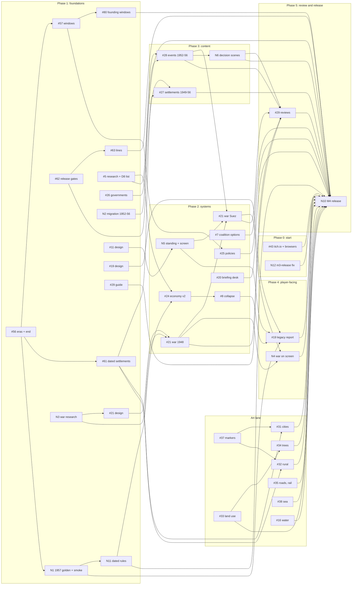

# Statecraft: Israel: M4 plan (the full 1948–56 slice)

- **Date:** 2026-10-10 (revised after staff review the same day)
- **Status: PROPOSED — owner review needed for the decisions in "Owner decisions"**
- **Issue:** #48 (roadmap tracker). Every work item below is an existing issue or a new issue drafted in
  "New issues"; this plan adds no other work.
- **Spec:** [2026-10-09-statecraft-israel-design.md](../specs/2026-10-09-statecraft-israel-design.md) §9: M4 is "All
  slice content, war mode (1948 and Suez), the legacy report and historian review"; M5 is "Polish and Steam page". The
  M3 plan's "Deferred to later plans" table adds to M4 the Diplomacy screen and system, the briefing desk, per-era 3D
  settlement art ("M4 (own plan)") and the full-slice smoke; the owner's visual rulings set promo 03 as the art bar.
- **Builds on:** [the chapters design](../specs/2026-10-10-chapters-architecture-design.md) (#53; the founding era is
  15 May 1948 to 1 January 1957, decision D3; items #56–#67) and, for boundary rules only,
  [the Yishuv design](../specs/2026-10-10-era-yishuv-design.md) (#49).
- **Format:** this is an ordering plan, like the "Parallel tracks" table of the
  [M3 plan](2026-10-10-statecraft-m3.md). It sets the order, the gates and the scope line. Each issue gets its own
  task-level plan (code, tests, observed totals) when someone picks it up. Sizes are effort, not dates: **S** one small
  PR; **M** one PR across a few files with tests; **L** several PRs, or one large one; **XL** a design plus several PRs
  across the sim and Unity.

## What exists today (checked against `main`, 2026-10-10)

| Area | Today | M4 gap |
|---|---|---|
| Play range | 15 May 1948 onward; content ends 31 Dec 1951; no end date (`GoldenRun` stops at 1000 turns). The historical run already reaches late 1956 without a game over (`Statecraft.Cli --auto historical --turns 62` ends 27 Nov 1956: reserves −634.5, stability 0.41, population 1,519,465) | No 1952–56 content; no end of the game (#56); the run never leaves the 1951 currency crisis |
| Content | 31 events (1948–51), 4 policies, 4 voter groups, 13 actors with a starting standing (not in state), 25 settlements, governments to the Third Government, the Second Knesset, aliyah and population to 1951 | 1952–56 everything; no emigration in the sim |
| Sim | Effects web, politics and coalition collapse, Cabinet and Appoint, budget and economy (calibrated 1950–51), population (arrivals and natural increase only), events with `requires`, security ladder with a ceasefire clock, map actions (transit camp, housing), saves, release gate for sensitive events | No war mode, no collapse of the state (#8), no actor standing, no rule values that change by date inside an era, `Mode.Open` throws, minister loyalty unused |
| Unity | HUD, Cabinet, Budget, Defence, Event card, Why panel, info panel, minimap, labels, New Game and autosave, golden and smoke checks in the player | No legacy report, Diplomacy screen, briefing desk, decision scenes or war map |
| Look | Visual v1 shipped (`docs/visual-v1.md`): light, tilt-shift, terrain, sea, grid, labels, tiers | Placeholder settlement markers; no kits, vegetation, land use, roads or rail |
| Goldens | `Hash1950` (last turn ends 27 Feb 1950, turn 35), `Hash1952` (last turn 27 Nov 1951 to 27 Feb 1952, turn 43), `SMOKE OK 5 turns` | No golden past February 1952; `SliceSmokeTests` stops at 1 Jan 1952 |
| Reviews | The seven sensitive events are `sensitivity-reviewed` (owner sign-off, commit 25d2ef6) | `docs/m3-release.md` still says they await review (N12) |
| Release | Local Brotli build; itch.io upload and the two-upload save test deferred to the start of M4 (`docs/m3-release.md`) | #43 |

## M4 is done when

All of the following hold on one merge candidate. Items marked *(owner)* need the owner; everything else is checked by a
test or a script.

1. **Playable end to end in the browser.** A new Historical game runs from 15 May 1948 to 1 January 1957 in the WebGL
   build. On 1 January 1957 the game ends with the legacy report (#56, #19). A game can also end early, by coalition
   collapse (exists) or by military or economic collapse (#8), and then shows the same report.
2. **The slice's content.**
   - Governments, ministers and the Third Knesset with the 1955 results (#26); immigration, emigration and population
     1952–56 (new N2).
   - About 40 events across 1948–56 (31 exist), covering every spec anchor: the reparations vote (January 1952), the
     agreement (10 Sep 1952, in force 27 Mar 1953), the New Economic Policy (February 1952), the 1955 election
     (26 Jul 1955), the Czech–Egyptian arms deal (27 Sep 1955) and Suez (1956) (#5, #28).
   - The decision scenes named in N6's agreed proposal (about six).
   - The sensitive 1952–56 events on the owner's list, shown as D8 says.
   - Policies and voter groups to the M4 target in D2 (#25).
   - Settlements founded 1949–56 appear on their dates (#61, #27); the 1949 armistice lines are drawn by date (#63).
   - Every fact sourced with a check date; every event at least `fact-checked`; every sensitive event and map row
     `sensitivity-reviewed` *(owner)*.
3. **War mode for 1948 and Suez** on the hex map at rung 5: operational campaigns, no tactical combat, outcomes from force
   balance, intelligence, doctrine and morale, limited by superpower pressure and the UN ceasefire clock (#21 sim, N4 on
   screen, N5 for the pressure), under D4's conditions. Deterministic, explained in the Why panel, and no option rewards
   an atrocity.
4. **The economy recovers** after 1952 as the sources say (#24, with N11's dated rules), and the historical run reaches
   1 January 1957 with the end-of-era reason, not a collapse (N1's test).
5. **Politics and diplomacy.** Event options can move coalition stability and support (#7); the briefing desk shows at
   most five items a turn (#20); actors have standing in the sim and a Diplomacy screen shows it (N5, scope in D3).
6. **Historian review** to the bar in D5 (#29) *(owner names the reviewers)*.
7. **The art minimum** in D6, with the measured bars below and the owner's verdict on the gameplay03 side-by-side
   *(owner)*.
8. **Verification.** `dotnet test sim/Statecraft.sln`, `tools/tests` and the Unity EditMode suite pass; the goldens follow
   the policy below, including a new 1957 golden; `SliceSmokeTests` play the full slice; the Brotli WebGL build passes
   `tools/web_check.py` with every `GOLDEN OK` line and the full-slice smoke; the frame-time and boot budgets of
   `docs/visual-v1.md` hold; Firefox, Safari and Windows are checked (#43); the shareable build passes the release gate
   (#62); `uv run scripts/oss/check_repo.py` passes.
9. **Shipped** to the project's itch.io page as the owner chooses (Restricted or Public) *(owner)*, recorded in a new
   `docs/m4-release.md` (N10), with D8's include and omit list.

### In M4, if ready, or later

These carry the M4 label but do not block M4 (D1). Each may land during M4 if its design is agreed and it passes the
same gates; otherwise it moves to the next plan with its issue unchanged.

| Issue | Why it does not block M4 |
|---|---|
| #10 Open mode, and the Historical Track meter (spec §4 "Meters") | Every anchor becomes conditional, which multiplies the test matrix; Suez in Open mode needs war mode and diplomacy first. The Historical Track measures drift from history, which only Open mode produces. M4 ships Historical mode |
| #9 Bills voted by the parties | The slice's votes (the reparations vote, the Law of Return) already work as events; bills are a new system that no M4 anchor needs |
| #22 Defence depth | War mode (#21) defines the minimum of command, intelligence and forces it needs; the full Defence system (procurement, manpower policy) is depth, not slice content |
| #23 Map actions beyond absorption | Historical settlements appear from data (#27, #61); player-built towns and kibbutzim are depth |
| N7 Delegation by loyalty, N8 dated budget lines | M3 Deferred correctness rows; both move the 1948–51 goldens and add no slice content. If ready, they join a rebaseline batch |

### M5, and what may run in parallel with M4

M5 is polish and the Steam page. Items that touch neither `sim/` nor `content/` cannot move a golden, so they may run
at any time during M4 without blocking it or being blocked:

- **Any time:** #47 (favicon), #39 (audio), #40 (settings), #41 (accessibility), #42 (onboarding), #45 (the AI
  disclosure generator and the store checklist; the trailer waits for the art), #36 (border skirt and the table/frame of
  promo 02), #6 and #30 (portraits; #30 must land before any commercial build), #1, #12.
- **After M4:** #54 (desktop and Steam) with its child N9 (shareable builds need `historian-reviewed` content), save
  export and import if #43's save test fails, the train and boats moving along #35's routes, screen-by-screen
  comparison (spec §8.5), the smaller download.
- **Not needed in M4:** save migrations. A save is the seed and the command log; new commands (war orders) add to the
  log without changing schema 1. Schema 2 is #64 (deferred).
- **Other tracks, not M4:** the Yishuv chapters (#49, #81–#99; #80 is scheduled here, see Phase 1), the chapters items
  they need (#58, #59, #60) and the deferred ones (#64–#67), later eras (#50–#52), Hebrew (#55). Their boundary rules
  are under "Rules shared with the Yishuv track".

## Owner decisions

Each has a recommended default; the plan proceeds with the default until the owner rules.

| # | Decision | Recommended default |
|---|---|---|
| D1 | The scope line | **As above:** #10 (with the Historical Track), #9, #22, #23, N7 and N8 are "if ready" and do not block M4. Everything in "M4 is done when" does |
| D2 | The slice content budget (spec §4: about 40 events, about 6 decision scenes, about 60 policies, about 15 voter groups) | **Events and scenes as the spec says. Policies about 20 and voter groups about 8 for M4**, the rest later. This deviates from spec §4 on purpose: each policy needs a sourced historical basis and calibration, and a policy no test calibrates is noise in the effects web |
| D3 | Diplomacy in M4 | **Actor standing in the sim, moved by events, war and policies, read by war mode and the legacy report, and shown on a read-only Diplomacy screen.** Player diplomatic actions and treaties come later, after #11's design. #11's design also says how standing relates to the `intl_standing` indicator, so nothing is counted twice |
| D4 | War mode and the 1948 goldens | **War mode replaces how the 1948 operations resolve, under five conditions:** (a) the code lands inert across its PRs (no content uses it; rung 5 behaves as today) and one final PR switches it on and rebaselines; (b) that PR moves `Hash1950`, `Hash1952`, `SMOKE OK 5 turns`, `Hash1957`, the legacy reference (#19, Phase 4) and any chain golden already pinned (#87); (c) `CalibrationTests` and `EconomyCalibrationTests` stay green with no refit of a pre-1952 parameter unless named in the PR; (d) any change to the options or effects of the five signed-off war events (`ten_days`, `operation_yoav`, `operation_hiram`, `operation_horev`, `altalena`) resets them to `fact-checked` for the owner to review again; (e) war mode never models the capture or depopulation of Arab localities as a mechanic or an outcome (the Lydda and Ramle precedent in `docs/m3-release.md`; chapters design §13), and #21's design gets the owner's sensitivity review before code. This supersedes the chapters design §8 line "the founding era's goldens are today's `Hash1950` and `Hash1952`, unchanged"; the switch-on PR amends that line and the §12 testing table's `DeterminismTests` row ("unchanged through every item in §15"). The alternative, keeping 1948 as events and using war mode only for Suez, misses spec §9 |
| D5 | The historian-review bar for M4 | **The review guide merged, at least one named reviewer, and recorded reviews for at least the war events (1948 operations and Suez) and the 1952–56 decision scenes.** Requiring every event to be `historian-reviewed` in shareable builds is N9, in M5, because it depends on volunteers outside the project |
| D6 | The art bar for M4 | **#31, #32, #33, #34, #35 (static roads and rail), #37, #38 and #16 are M4; #36, the moving train and boats, and #39 are M5.** M4 art is done when the measured bars below hold and the owner says the gameplay03 side-by-side reads as promo 03. **Fallback**, if the art lane is the last thing open: one archetype per kit family (a Tel Aviv block, a Mandate town, a kibbutz, a ma'abara, an Arab village) plus citrus and olive trees, with the rest of #31 and #32 moving to M5; the owner chooses the fallback, it is not taken by drift |
| D7 | The 1957 golden | **Pinned early (N1, end of Phase 1) and moved on purpose by every 1952–56 content PR**, each with a history row; frozen at the M4 merge candidate. Pinning only at the end would leave the 1952–56 work with no determinism check. It keeps the founding naming (`Hash1957`) rather than the chapters design's `Hash_<era>_<year>`; #60 may rename all three founding constants together later **Its run ends on the last turn that ends before 1 January 1957**, the boundary into the next era (#50): `GoldenRun.Until1957` is set so the run's final turn ends before 1957-01-01, and a test asserts it. The end-of-era check (the historical run reaches 1 January 1957 with the end-of-era code, not a collapse) is a separate test whose state is not pinned. The full-slice smoke line pins the same last turn. The legacy reference (#19) is read from the run played to 1 January 1957 at the read point: after the boundary turn's normal step and the ending era's pending-event resolution (Yishuv design §8.3 steps 1–3), before `ContentWindows.Update`; the end-of-last-era path (chapters design §4.5) runs the same steps 2–3, so this state is the same whether or not a next era exists. So adding the next era moves no founding constant (1957–1977 design §9.2). |
| D8 | Sensitive content 1952–56 (mirrors the Yishuv design's D6) | **Five rules.** (1) **Reprisals are decided at the level of policy and doctrine:** activist against restraint (the debate between Sharett and Ben-Gurion and Dayan) and the rung-3 order. A specific raid's civilian deaths are never an option and never rewarded. (2) **Qibya (14–15 October 1953)** appears as a react-only consequence event tagged `massacre`; no option that conceals or denies it gains standing or score; any government statement is shown only as a sourced fact, never as an invented quote. (3) **Kafr Qasim (29 October 1956)** appears as a react-only event tagged `massacre`; its options are the government's real responses (censorship, the inquiry, the trial). Mainstream Israeli sources and the Israeli court use the word "massacre", so this does not conflict with the perspective rule. War mode never models curfews or measures against Arab citizens as orders. (4) **An owner list:** #5 drafts, and the owner rules on, include, omit or how-to-show for each candidate (dates to verify in #5): the Yehud attack (October 1953), Ma'ale Akrabim (17 March 1954), Operation Black Arrow (28 February 1955; it bears on the arms-deal anchor), the Lavon affair and Operation Susannah (1954–55), the Kasztner trial (verdict June 1955; `holocaust`; it bears on the 1955 government crisis), the Shafrir attack (April 1956), Kalkilya (October 1956), the killings in Khan Yunis and Rafah during Kadesh (November 1956), and the military government over Arab citizens (throughout). (5) **No omission bypasses the owner:** leaving a candidate out needs the owner's explicit approval, as Lydda and Ramle did; the list is recorded in `docs/m4-release.md` (N10) |

The chapters design's decisions D1–D6 are separate; M4 needs only its D3 (the founding era's dates), already used here.

## Phases and dependencies

Lanes run in parallel; arrows are hard dependencies. Items on a critical chain are in bold in the tables. Three chains
decide when M4 can finish; which is longest depends on people, so the plan names the assumption:

- **Art chain:** #37 → #31 and #32 style tests → the kits (#31 is XL, one archetype per PR) → the D6 checkpoint → N10.
  The owner was told the art track is several months of work, and the project has no art contributors today. **With
  no art contributor, this is the longest chain.** D6's fallback is the lever; the sim lanes never wait for it.
- **War chain:** N3 research → #21 design (with the owner's sensitivity review, D4e) → #21 sim, 1948 (inert, then the
  D4 switch-on PR) → #21 sim, Suez (with N5, #5's Suez note and #28's road-to-Suez events) → N4 on screen → #29
  reviews of the war events → N10. **Longest if art has a contributor.**
- **End-of-game chain:** #56 → N1 → N11 → #24 → #8 → #19 → N10.

Content (#5 → #26 → #28 → N6) is long but parallel; it joins at #29 and N10.

#7 is not an edge into all of #28: only the #28 events whose options move coalition stability or support (for example
a 1952–56 government crisis) wait for it.

### Phase 0: start of M4 (owner first)

| Item | Size | Needs | Notes |
|---|---|---|---|
| Owner rules on D1–D8 | — | this plan | Until then the defaults apply |
| #43 itch.io private Draft, the two-upload save test, Firefox, Safari, Windows | M *(owner uploads)* | — | Unblocked: the seven sensitive events are `sensitivity-reviewed` (25d2ef6), so the `-shareable` build passes the gate. If the save does not survive a re-upload, save export and import moves from M5 into M4 |
| N12 `docs/m3-release.md` still says the seven events await review | S | — | Its "OWNER STEP" section and Known limits line are stale |
| #47 favicon | S | — | good first issue |

### Phase 1: foundations (all lanes in parallel)

| Lane | Item | Size | Needs | Notes |
|---|---|---|---|---|
| Chapters | **#56 `eras.yaml`, the era lookup, the end at 1 Jan 1957** | S–M | chapters D3 | Golden-safe (its done-when). The end sets `GameOver` to a stable code (as `coalition_collapse` is), with the text derived, so wording never moves `Hash1957` |
| Chapters | #57 dated windows for model records and offices | M–L | #56 | Makes a later policy or voter group golden-safe, if its window opens after the run it would touch (see "Goldens policy"); without it every new `model.yaml` record moves both goldens (chapters design §2) |
| Chapters | #80 window the Founding-only records, split Dori's term | S | #57 | Golden-safe (its done-when); lands early so M4 and Yishuv PRs date new records the same way |
| Chapters | #61 one dated `settlements.yaml` | M | #56 | Agrees #27's file shape; the kits (#31, #32) read it |
| Chapters | #62 release gates for living people and sensitive map rows | S–M | — | Needed before #27 adds `until` rows or renames, and before #63 |
| Chapters | #63 dated lines (`lines.yaml`, the 1949 armistice lines) | M | #62 | Every entry needs the owner's sensitivity review before a shareable build |
| Goldens | **N1 the 1957 golden and the full-slice smoke** | S–M | #56 | Pins `Hash1957` (D7); `SliceSmokeTests` to 1 Jan 1957; a full-slice smoke in the browser; coordinates its `GoldenCheck` change with #60's one-line-per-run design |
| Rules | **N11 rule values that change on a date inside an era** | M | N1 | Lets #24 give the NEP its own parameters from February 1952 without touching 1948–51 values, so `Hash1950` and the M3 calibration stay |
| Research | **#5 research notes 1952–56, and D8's candidate list** | L | — | Split by event; the NEP note first (it feeds #24), then reparations, the 1955 election, the arms deal, the road to Suez. #5 also drafts D8's include/omit list for the owner |
| Research | #26 governments, ministers, the Third Knesset | M | — | Content with loader tests. #2 and #4 touch the same files: land them first or in the same PR series. Also settles the M3 Deferred row "Ministers of Immigration and of War Victims after 8 Oct 1951" (re-add a term only if a source shows the portfolio) |
| Research | N2 immigration, emigration and population 1952–56 | M | — | CBS series, as M3 Task 3 did for 1950–51, plus a dated emigration series (the sim has none) |
| Research | #24 step 1: the 1952–56 annual series (CBS, Bank of Israel) | M | — | No code |
| Research | **N3 forces, fronts and operations of 1948 and 1956** | M | — | Feeds #21's design and data |
| Research | #27 settlements founded 1949–56, by region | L | #61's shape | Data lands after #61 and #62 |
| Research | #16 note: the 1948 Dead Sea level and the Hula lake and swamp | S | — | The bake change follows in the art lane |
| Research | #3 budget approval 1948–56 | S | — | Open question on the Third Knesset record too |
| Design | **#21 war mode design** (agreed in the issue) | M | N3 | Must say: fronts on hexes, what a weekly turn resolves, how Yoav, Hiram, Horev and Kadesh fit as anchors, what it reads from N5, the Why lines, and how it meets D4 (inert landing; no depopulation mechanic). Founding war mode is gated on rung 5; it adds no `war_mode` key (see "Rules shared with the Yishuv track"). The owner's sensitivity review of the design comes before code |
| Design | #11 diplomacy design, to D3's scope | S–M | — | Standing, what moves it, what reads it, the screen, and its relation to `intl_standing` (which one the legacy report's "international standing" score reads) |
| Design | #19 legacy report design | S–M | — | The six scores, each from existing state; the "what happened" side from a slice-local reference written by a tool from the historical run played to 1 January 1957 (see Phase 4) |
| Design | #8 collapse thresholds and grace periods | S | — | Must leave the historical run alive to 1957 |
| Design | #20 briefing ranking proposal; N6 decision-scene proposal naming its scenes, under D8 | S each | — | |
| Review | #29 the review guide (`docs/HISTORIAN_REVIEW.md`) and the first reviewer | S *(owner finds reviewers)* | — | Start with the 1948–51 events that M4 does not change: not the five war events (D4), the armistice and reparations events (N5) or the 1951 education crisis (#7) |
| Art | #37 markers on the ground (shadow bias) | S | — | First, so every later art checkpoint judges grounded objects |
| Art | #38 sea and gold-hills saturation | S–M | — | Before the kits, so their colour is judged against the final sea |
| Art | #31 and #32 style tests (one archetype each) and reference photos | M | — | Public-domain or CC0 references; not the GPO collection (#30) |
| Art | #33 land-use data proposal; #35 route research | M each | — | Both are sourced data first |

### Phase 2: sim systems

| Item | Size | Needs | Notes |
|---|---|---|---|
| **#24 economy calibration v2 and the NEP** | L | #5 NEP note, #24 step 1, N1, N11 | NEP parameters through N11, dated from the NEP. The code lands inert; the values act in February 1952, inside the `Hash1952` run, so they go in batch 1, which closes when #24 is ready ("Batch them", below). No 1948–51 parameter moves unless named |
| **#8 military or economic collapse** | M | #24, #8 design | N1's test (the run ends on the end-of-era reason) must pass with it on |
| #7 event options move coalition stability and support | S–M | — | The code lands inert on `main`; its first real use, the 1951 education crisis, moves `Hash1952` and goes in a batch. 1952–56 events can use it as soon as the code is in |
| **N5 actor standing in the sim and the Diplomacy screen** | M–L | #11 design | The standing code and screen land inert on `main` (no event moves standing yet), so #21 Suez and #19 can build on them; the armistice and reparations events that move standing move `Hash1950` and `Hash1952` and go in a batch |
| **#21 war mode sim, 1948** | XL | #21 design, N3 | Lands inert; the D4 switch-on PR rebaselines. The 1948 operation events stay the anchors |
| **#21 war mode sim, Suez** | L | 1948 part, N5, #5 Suez note, #28 road-to-Suez events, #26 (Dayan as Chief of Staff), the map extent to Sinai (#129, the 1957–1977 design's D9, in M4's scope) | Moves only `Hash1957` and the legacy reference |
| #25 policies and voter groups, to D2 | M per batch | #57 | Records whose window opens after 27 Feb 1952 are golden-safe through #57; earlier ones join a rebaseline batch |
| #20 briefing desk (sim ranking, then the desk UI) | M | proposal | Read-only: goldens unchanged |
| #61 then #27 data | L | #61, #62, research | Goldens unchanged (#61's done-when); `settlement_hexes.yaml` rebuilt |

### Phase 3: content 1952–56

| Item | Size | Needs | Notes |
|---|---|---|---|
| **#28 events 1952–56** | L (one PR per event or small group) | #5, #26; #7 for events that use it | The reparations vote (January 1952) and the NEP event (February 1952) fire inside the `Hash1952` run and join the 1952 batch; events from March 1952 move only `Hash1957`. Each PR says which goldens it moves. Sensitive events follow D8 and get the owner's review before any shared build |
| N6 decision scenes | M (screen) + content | N6 proposal, #28 | Scenes are events with a richer screen; the sim sees an ordinary event. The reprisal scene follows D8 rule 1 |
| N2 rows land | S | N2 research | The 1952 rows add January and February 1952 people inside the `Hash1952` run: 1952 batch |
| #63 lines and #27 settlements reviewed | S *(owner)* | #62 | Sensitivity review of `until` rows, renames and every line |

### Phase 4: player-facing

| Item | Size | Needs | Notes |
|---|---|---|---|
| **#19 legacy report** | L | #19 design, #56, #8, N1, N5 | Sim scores with tests; a UI Toolkit screen; shown at 1 Jan 1957 and on an early end. #19 builds the reference writer for the end of the founding era (for example `legacy/founding.reference.yaml`, from the historical run played to 1 January 1957 and read after the boundary turn's normal step and the ending era's pending-event resolution (Yishuv design §8.3 steps 1–3), before `ContentWindows.Update` — the end-of-last-era path runs the same steps, so the reference is the same whether or not a next era exists — with values as IEEE hex doubles like #59's files) and a test that regenerates and compares it; #59 reuses the tool for boundaries later |
| **N4 war mode on screen** | L | #21 sim (both parts) | Fronts and orders on the hex map, unit markers at symbolic scale; no rules in Unity. War orders are optional, so the smoke's first-option path still plays |
| #20 desk UI, N5 screen | M each | their sim parts | |

### Art lane (parallel to Phases 1–4)

| Item | Size | Needs | Notes |
|---|---|---|---|
| #37, #38 | S, S–M | — | Phase 1 |
| #31 city kits (Tel Aviv, Jaffa, Haifa, Jerusalem, Mandate towns) | XL | #37, #61, style test | One archetype per PR; each replaces the markers for that archetype |
| #32 rural kits (kibbutz, moshav, ma'abara, Arab village, Negev outpost) | L | #37, #61, style test | The ma'abara kit shows the player's `transit_camp` |
| #33 land use in the terrain shader | L | land-use data | Edit `tools/terrain_graph.py`, not the graph |
| #34 citrus and olive trees, scrub | M–L | #33 | GPU instancing; draw calls checked with `?vprofile` |
| #35 roads and the railway (static) | L | route data | The moving train and boats are M5 (D6) |
| #16 1948 water bodies | M | #16 note | `tools/terrain_bake.py` reads the data; visual only |

### Phase 5: review and release

| Item | Size | Needs | Notes |
|---|---|---|---|
| #29 reviews to the D5 bar | M *(reviewers)* | guide, #21 (both parts), N6, #28 | Reviews recorded in the YAML as the guide says |
| Owner sensitivity reviews of every new sensitive event and map row, and of D8's list | S–M *(owner)* | #28, #27, #63, #5 | The shareable build refuses until done |
| **N10 the M4 release** | M | everything above | Full-slice WebGL build, all checks, the final art checkpoint, `docs/m4-release.md` (with D8's list), the owner's upload |

## Gates per phase

### Goldens policy

The three places each golden lives (`GoldenRun.cs`, `DeterminismTests.cs`, `docs/determinism.md`) change together, in one
commit, with a history row and the reason in the commit message, as today.

**What "golden-safe" means.** A run stops on the first turn whose date is on or after its `until`. So the `Hash1952`
run's last turn is 27 November 1951 to 27 February 1952, and the `Hash1950` run's last turn ends 27 February 1950.
`PopulationSystem.Arrivals` spreads each aliyah row over the days it overlaps a turn, and `EventSystem.Trigger` fires an
event whose `from` is on or before the turn's end date; fired and pending ids are hashed. **A change is safe for
`Hash1952` only if it first acts after 27 February 1952, and for `Hash1950` only if it first acts after
27 February 1950.** A record dated 1 January 1952 is not safe. The project met this before (history row "M3 Task 3,
1950": January–February 1950 arrivals inside the run).

**Named moves of the 1948–51 goldens.** Nothing else in M4 may move `Hash1950` or `Hash1952`:

| Item | Moves | Why |
|---|---|---|
| N2's 1952 aliyah and emigration rows | `Hash1952` | January–February 1952 people inside the run |
| #28's reparations vote and NEP event | `Hash1952` | They fire in the last turn |
| #24's NEP parameters (through N11) | `Hash1952` | They act from February 1952 |
| #2, a sourced holder of `rationing_minister` from 8 October 1951 | `Hash1952` | A holder's competence replaces the vacant 0.5 in `rationing_feeds` |
| #4 deputy ministers | check in the PR | Moves only if a deputy holds an office the sim reads |
| #7's use on the 1951 education crisis | `Hash1952` | Its first real use |
| N5 standing moved by the armistice and reparations events | `Hash1950`, `Hash1952` | Standing becomes hashed state where it leaves its default |
| #25 records whose window opens by 27 February 1952 | the runs they reach | New keys in the hashed maps |
| #21 1948, the D4 switch-on PR | `Hash1950`, `Hash1952`, `SMOKE OK 5 turns` | D4 |
| N7, N8 (if ready) | `Hash1950`, `Hash1952` | They change 1948–51 rules |

**Batch them.** Each item above is split in two. Its **code** lands on `main` as soon as it is reviewed, **inert**: no
content uses it yet, so no 1948–51 golden moves (N5's standing machinery, #7's option effect, N11's dated rules, the
#24 code paths). Only the **content or parameter** that moves a 1948–51 golden goes in a batch: N2's 1952 rows, the
reparations vote and NEP events, #24's NEP values, #2's holder, and the 1949–51 events that start using #7 and N5.
A batch is one PR, opened when its items are ready and merged as one rebaseline commit with one history row per item;
there is no long-lived branch to keep re-pinned while `Hash1957` moves on `main`. **Batch 1 closes when #24 is ready,
because #8 waits on it;** whatever is not ready then goes in batch 2 or in D4's switch-on PR. Two rebaselines of the
1948–51 goldens in M4 is the target, three the limit.

| Golden | Policy in M4 |
|---|---|
| `Hash1950`, `Hash1952` | **Frozen** except the named moves above, in batches. The chapters items (#56, #57, #61–#63, #80), #19, #20, N4, N6 and every art issue leave them unchanged; where an issue's done-when does not say so yet (#16, #19, #33, #34, #35, #37, #38), the plan's rule applies and the PR states it |
| `Hash1957` (N1) | **Moving** until the M4 merge candidate: every PR with 1952–56 content or rules moves it on purpose and says so. Frozen at N10 |
| The legacy reference (#19) | Regenerated in the same commit as every `Hash1957` move, and with any change that acts on the final turn to 1 January 1957; a test compares it |
| `SMOKE OK 5 turns` | Moves only with the 1948 rules (#21) or the UI path. War orders (N4) are optional and decision scenes (N6) keep the event card's first-option path, so neither moves it; a PR that cannot keep that names the move |
| The full-slice smoke line (N1) | Moves with `Hash1957` and with any UI path change (#19, #20, N4, N6); each PR says so |
| Chain goldens (#87, #60) | If pinned, every founding rebaseline also moves them (chapters design §8, "Rebaselines stay local"), in the same commit |

Golden-moving PRs merge one at a time, rebased on each other, so the constants never conflict. A golden that moves
without a stated reason is a determinism bug.

### Tests per phase

| Phase | Sim (`dotnet test`) | Unity EditMode | WebGL (`tools/web_check.py`) |
|---|---|---|---|
| 0 | — | — | #43's browser results recorded in `docs/m3-release.md` |
| 1 | Each chapters item's fixture tests; `SliceSmokeTests` to 1957 (N1); N11's loader tests; content loader tests for #26 and N2 | `SimSmokeTests` prints a `GOLDEN OK` line per pinned run, 1957 included | `--expect` gains `GOLDEN OK 1957`; the full-slice smoke plays to the end |
| 2 | Per-system unit tests; the historical run ends on the end-of-era reason, never a collapse; `CalibrationTests` and `EconomyCalibrationTests` stay green through every rebaseline; war mode determinism across cultures (`CultureTests` pattern); `HistoricalAI` issues the historical war orders | Screens added in this phase pass `UiLayoutTests` at 1280×720 | All goldens and both smokes after each golden-moving PR |
| 3 | Content tests: sources, `{office}` placeholders resolve on the event's date, no invented quotes, no reward on sensitive options, `requires` only backwards; the 1952–56 population calibration (N2) | `PlayerTextTests`-style guards on new screens (no ids, dates as "15 May 1948") | Full-slice smoke still passes |
| 4 | Legacy scores deterministic, computed in the sim, one test per score; the legacy reference regenerates equal | The legacy report, the war map, the desk and the Diplomacy screen pressed with `NavigationSubmitEvent`, not `ClickEvent` | Full-slice smoke ends on the legacy report |
| 5 | Release gate (`Statecraft.Cli --release-gate`) passes on the shareable content | Whole suite, `-buildTarget OSXUniversal` | Brotli build: every `GOLDEN OK`, full smoke, budgets, file count under itch.io's 1,000 |

Every Unity run follows the visual plan's rules: edit-mode under `tools/machine_lock.py --shared`, frame-time runs under
`--exclusive --wait-unity`, no new compiler warnings, and `git checkout -- unity/Assets/Settings
unity/ProjectSettings/ProjectSettings.asset` after a player build. Never script the Unity editor with AppleScript or
`open -a`.

### Art checkpoints

Every art PR runs `tools/art_checkpoint.sh <name>` and attaches the side-by-side and colour-blind images against
`promo/final/03-gameplay-1936.png` and `02-map-diorama.png`. Per PR the owner's verdict is non-blocking, as in visual v1;
at the M4 art gate (D6) it is blocking. Every art PR also states that `git diff --stat <base>..HEAD -- sim content`
prints nothing and the goldens are unchanged. The measured bars (from `docs/visual-v1.md`):

| Bar | Today | M4 |
|---|---|---|
| diorama02 warmth | 0.1038 | stays in 0.087–0.145 |
| diorama02 saturation (skirt included) | 0.4686 | stays ≤ 0.48 |
| gameplay03 saturation against promo 03 (0.382) | 0.5655 (+0.18) | gap at most half of today's (≤ +0.09); the owner may ratify another value at D6 |
| Headless p95, both poses, all features | 5 / 11 ms | ≤ 16.7 ms; each feature ≤ 2.5 ms over `-feature` |
| DPR-2 headed p95 (weak-GPU proxy) | 5 / 20 ms | ≤ 33 ms |
| Boot spans | 426 / 3477 ms (`--cpu 1`) | within max(300 ms, 50%) of the visual v1 baselines |
| Brotli download | recorded in `docs/m3-release.md` | recorded per art PR; growth named in the PR |

Kits and trees register a `VisualToggles` switch each, so `?vprofile` can price them, and every new shader passes the
GLES3 compile check. Every asset has an `ASSETS.yaml` row (with `ai_generated: true` where it applies). #16 and
#33–#38 do not carry the M4 label today; the owner adds it to the ones D6 puts in M4.

## Rules shared with the Yishuv track

The Yishuv work (#49) and M4 both touch the founding era. These rules keep them apart:

1. **Yishuv work never moves the Founding goldens** (Yishuv design §8.4). M4 work does, only as listed above.
2. **The founding start stays put.** `rules.yaml` `start`, `start_rung`, the starting money, population and
   `budget_start` are the fresh Founding start that #87's carry invariant compares against (a historical chain from
   1882 must equal a fresh Founding start, bit for bit). An M4 change to them moves #87's chain golden and that
   invariant: the PR updates both if #87 has landed, or says so in #87 if it has not.
3. **New founding-era records are dated.** Once #57 and #80 land (both in Phase 1), new policies, effects and actors
   that only make sense in a state carry `from: 1948-05-15` (or their real later date).
4. **#81 owns the `war_mode` key.** Founding war mode (#21) is gated on rung 5, which exists today, and adds no switch,
   so it does not depend on #58. #81's switch caps the rung at 4 in the Yishuv eras, which makes war mode unreachable
   there with no change to #21.
5. **One reference writer.** #19 builds the tool that writes a historical-run reference (the end of the founding era);
   #59 reuses it for boundary carry files.
6. **Events never span a boundary.** M4 events open on or after 15 May 1948 and close by 1 January 1957. The Sinai
   withdrawal of March 1957 belongs to the next chapter (#50) and needs a new event id (`sinai_withdrawal` is already
   the 1949 Horev withdrawal); the legacy report scores the state on 1 January 1957.

## Risks

| Risk | Mitigation |
|---|---|
| The art lane has no contributor and is the longest chain | D6's owner-chosen fallback; style tests first; the art lane never blocks the sim lanes |
| War mode grows without bound | Design agreed in #21 before code; operational fronts only; 1948 first, Suez second; inert landing (D4a); #22's depth stays out (D1). Fallback if the Suez part stalls: Suez as hard events on the 1948 campaign model, decided by the owner, not by drift |
| The historical run stays in the 1951 currency crisis (reserves about −634 by late 1956 today) and #8 ends it | N11 and #24 land before #8; N1's end-reason test runs on every PR after it |
| A "Hash1957-only" change moves `Hash1952` because it acts in January–February 1952 | The golden-safe definition above; the named-moves table; one batch branch |
| Golden churn and merge conflicts as many PRs move `Hash1957` | One golden-moving PR at a time; `Hash1950`/`Hash1952` moved only in batches |
| Changing the five war events undoes the owner's sensitivity sign-off | D4d: any change resets them to `fact-checked` for review again |
| Sensitive 1953–56 events are left out or framed by contributors | D8: policy-level reprisal choices, react-only Qibya and Kafr Qasim, an owner include/omit list, no omission without the owner |
| Historian reviewers do not appear | Start #29 in Phase 1 with the 1948–51 events M4 does not change (not the war, armistice, reparations or education-crisis events); D5 sets an M4 bar the project controls; the full gate is M5 (N9) |
| Arrivals alone cannot fit the 1952–56 population (emigration in 1953 roughly matched immigration) | N2 adds a dated emigration series and checks the natural-increase rate |
| Kits and trees break the WebGL frame or download budget | Instancing; one archetype per PR, each measured; the runtime quality fallback (#44); growth named per PR |
| GPO portraits are a US copyright risk | #30 runs in parallel; it gates a commercial build, not M4 |
| itch.io loses saves across uploads | #43 runs first, in Phase 0, so the fallback can join M4 if needed |
| Yishuv and M4 PRs collide in `model.yaml`, `offices.yaml`, `rules.yaml` | The shared rules above; #57 and #80 land in Phase 1; one owner of each file per merge window |

## New issues

Drafted for the owner to file once this plan is on `main` (their links point to it); until then they are referred to
here as N1–N12. Each follows the What / Context / Done when / Depends on shape with the standard footer and
"Part of #48." Labels come only from `scripts/oss/github/labels.tsv`.

| Id here | Title | Labels | Phase |
|---|---|---|---|
| N1 | Full-slice golden and smoke: play 15 May 1948 to 1 January 1957 in the tests and the browser | enhancement, help wanted, area: sim, area: unity, M4 | 1 |
| N2 | Immigration, emigration and population 1952–1956 from the CBS series, calibrated | help wanted, content, research, area: sim, M4 | 1–3 |
| N3 | Research: forces, fronts and operations of 1948 and 1956 for war mode | help wanted, content, research, M4 | 1 |
| N4 | War mode on screen: fronts, campaign orders and unit markers on the hex map | enhancement, help wanted, area: unity, area: art, area: design, M4 | 4 |
| N5 | Diplomacy build: actor standing in the sim and a read-only Diplomacy screen | enhancement, help wanted, area: sim, area: unity, M4 | 2 |
| N6 | Decision scenes: the full scenes of the 1948–56 slice | enhancement, help wanted, content, area: unity, area: design, M4 | 1, 3 |
| N7 | Delegation uses minister loyalty (spec §4 step 2) | enhancement, help wanted, area: sim, area: design, M4 | if ready |
| N7 ruling | **Then decided (owner, 18 Oct 2026, "all defaults"; [#107](https://github.com/eyalgolan/statecraft-israel/issues/107#issuecomment-6249501765)):** yes: minister loyalty changes a delegated event's outcome, with labelled values in the PR. | | |
| N8 | Budget lines owned by office and date | enhancement, help wanted, area: sim, M4 | if ready |
| N9 | Release gate: shareable builds carry only historian-reviewed content | enhancement, help wanted, area: sim, area: tools | M5 (child of #54) |
| N9 ruling | **Then decided (owner, 18 Oct 2026, "all defaults"; [#109](https://github.com/eyalgolan/statecraft-israel/issues/109#issuecomment-6249501942)):** historian review is not a release gate for the MVP; it sits behind a flag. **Then decided (owner, 18 Oct 2026, "Not now; after the MVP"; [#109](https://github.com/eyalgolan/statecraft-israel/issues/109#issuecomment-6252484277)):** Don't build the flag yet. #109 stays post-MVP, as its body says (it depends on #29 and #62), and the 'reviewed' rule (decision 7 in `docs/historian-review-proposal.md` §6) is decided then. | | |
| N10 | M4 release: the full-slice browser build, its checks and the owner's upload | documentation, help wanted, area: unity, area: tools, M4 | 5 |
| N11 | Rule values that change on a date inside an era | enhancement, help wanted, area: sim, M4 | 1 |
| N12 | docs/m3-release.md still says the seven sensitive events await review | documentation, good first issue, help wanted | 0 |

## Where every M4-labelled and related issue goes

| Issue | Place |
|---|---|
| #5, #26, #27, #28 | Phases 1 and 3 (content); #5 also drafts D8's list |
| #7, #8, #24, #25, #20 | Phase 2 |
| #11 | Phase 1 design; built as N5 |
| #21 | Phase 1 design; Phase 2 sim (1948 inert then switched on, then Suez); N4 on screen |
| #19 | Phase 1 design; Phase 4 |
| #29 | Phase 1 guide; Phase 5 reviews (D5) |
| #18 | Goal tracker; M4 delivers its "art track" step to D6's bar |
| #31–#35, #37, #38, #16 | Art lane (D6) |
| #36 | M5 (D6), may run any time |
| #9, #10, #22, #23 | If ready (D1) |
| #56, #57, #61, #62, #63, #80 | Phase 1 (chapters and Yishuv items with an M4 user) |
| #58, #59, #60, #64–#67, #81–#99 | Yishuv and later eras, not M4 |
| #1, #2, #3, #4 | Phase 1 research lane; #2 and #4 before #26's PRs; #2 (and #4 if it reaches the sim) join the 1952 batch |
| #6, #30 | Parallel; #30 gates a commercial build |
| #43 | Phase 0 |
| #39–#42, #45, #47 | Parallel (M5) |
| #54, #55, #12 | After M4 / other tracks |

## Review notes not taken

From the staff review of the first draft, every Critical and Important item and the Minor items are applied, except:

- **Moving the plan's links in the drafts to a commit hash** (Minor 11): not done. The drafts are to be filed after
  this plan merges, which keeps the `main` links valid and readable.
